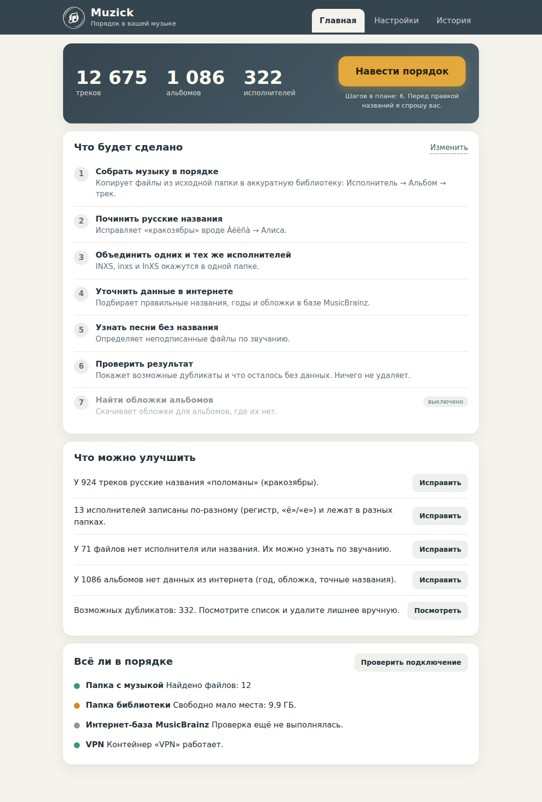
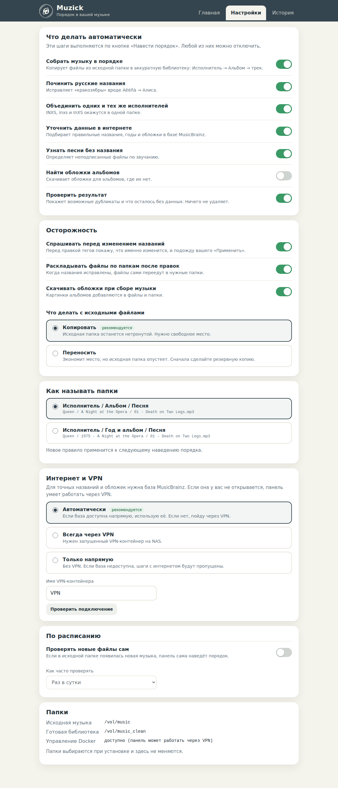
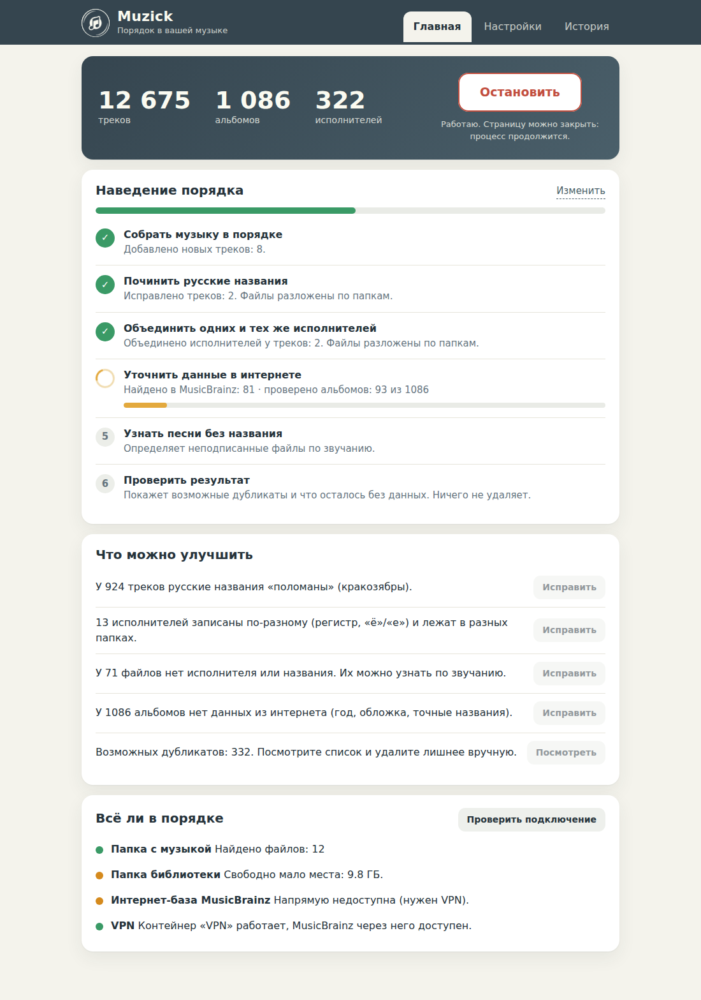

# Muzick Beets Panel

Веб-панель для управления музыкальной библиотекой на базе [beets](https://beets.io/). Проект рассчитан в первую очередь на Synology DSM с Docker / Container Manager и помогает импортировать, проверять, тегировать и организовывать музыкальные файлы.

> **Важно:** перед первым импортом и включением автоматической обработки протестируйте настройки на небольшой копии музыки. Не запускайте обработку единственной копии ценных файлов, пока не проверите результат.

## Возможности

- Веб-интерфейс для запуска и контроля операций beets.
- Импорт музыки из исходной папки в отдельную библиотеку.
- Выбор папок в интерфейсе в пределах подключённых Docker-каталогов загрузок и библиотеки.
- Автоматическая проверка новых файлов с задержкой, чтобы не начинать обработку файла, который ещё загружается.
- Работа с MusicBrainz и поддержка запуска соответствующих задач через заданный VPN-контейнер.
- Утилиты для исправления тегов, анализа дубликатов и организации библиотеки.
- Хранение конфигурации и базы beets на NAS вне жизненного цикла контейнера.
- Управление контейнерами и типовыми операциями через `muzick.sh`.

## Скриншоты

Изображения интерфейса находятся в каталоге [`docs/`](docs/):

- `docs/panel-home.png` — главная страница.
- `docs/panel-settings.png` — настройки.
- `docs/panel-running.png` — выполняющаяся задача.

Если скриншоты доступны в репозитории, их можно отобразить прямо на GitHub:

| Главная страница | Настройки |
|---|---|
|  |  |



## Архитектура и каталоги

Типовая установка на Synology:

- `BASE_DIR` — каталог проекта и конфигурации, по умолчанию `/volume1/docker/beets`.
- `SRC_DIR` — исходная папка загрузок.
- `LIB_DIR` — конечная музыкальная библиотека.
- `WORK_DIR` — папка, в которой разрешены операции «на месте».
- `BASE_DIR/config/` — конфигурация beets, база данных и вспомогательные скрипты.
- Контейнер `beets` — основной контейнер beets.
- Контейнер `beets-panel` — веб-панель.

Контейнеры используют постоянные каталоги NAS для конфигурации и музыки. Удаление контейнеров командами проекта не должно удалять эти каталоги, но перед обновлением всё равно рекомендуется делать резервную копию.

## Требования

- Synology DSM с установленным Docker / Container Manager либо Linux-сервер с Docker.
- SSH-доступ и права `root`/`sudo` для установки.
- Доступ к образу `lscr.io/linuxserver/beets:latest`.
- Существующий каталог `SRC_DIR`.
- Достаточно свободного места для музыкальной библиотеки и резервных копий.
- Если задачи MusicBrainz должны выполняться через VPN — запущенный Docker-контейнер VPN и его точное имя.

Проект использует порты по умолчанию:

- `8338` — веб-панель.
- `8337` — веб-интерфейс основного контейнера beets.

Убедитесь, что эти порты не заняты. При необходимости измените их в `.env`.

## Установка на Synology

### 1. Получите проект

Склонируйте репозиторий в рабочий каталог NAS либо загрузите и распакуйте архив проекта. Например, при установленном Git:

```bash
sudo -i
mkdir -p /volume1/docker
cd /volume1/docker
git clone <URL-ВАШЕГО-РЕПОЗИТОРИЯ> muzick-beets-panel
cd muzick-beets-panel
```

Замените `<URL-ВАШЕГО-РЕПОЗИТОРИЯ>` на адрес репозитория GitHub. Если Git не установлен, можно загрузить ZIP-архив репозитория и распаковать его в этот каталог.

### 2. Подготовьте каталоги

Пример путей:

```bash
mkdir -p /volume1/downloads
mkdir -p /volume1/music
mkdir -p /volume1/docker/beets
```

Используйте свои реальные пути. Исходная папка должна существовать до запуска установщика.

### 3. Создайте `.env`

Скопируйте шаблон в каталог установки, который будет использоваться для хранения настроек:

```bash
cp .env.example /volume1/docker/beets/.env
chmod 600 /volume1/docker/beets/.env
```

Отредактируйте `/volume1/docker/beets/.env` и проверьте как минимум следующие параметры:

```dotenv
BASE_DIR=/volume1/docker/beets
SRC_DIR=/volume1/downloads
LIB_DIR=/volume1/music
WORK_DIR=/volume1/downloads
DOCKER_ACCESS=1
PANEL_FILE=panel.py
VPN_CONTAINER=VPN
PANEL_PORT=8338
WEB_PORT=8337
IMAGE=lscr.io/linuxserver/beets:latest
TZ_NAME=Europe/Berlin
PUID=1026
PGID=100
PANEL_PASS=ЗАМЕНИТЕ_НА_СЛОЖНЫЙ_ПАРОЛЬ
```

Значения `SRC_DIR`, `LIB_DIR`, `WORK_DIR`, `PUID`, `PGID`, `TZ_NAME` и `VPN_CONTAINER` — примеры. Укажите реальные значения для своего NAS. Если VPN для задач MusicBrainz не используется, задайте `VPN_CONTAINER=`. Не оставляйте пароль `CHANGE_ME` и не публикуйте `.env` в GitHub.

### 4. Запустите установщик

Из каталога, куда был распакован или склонирован репозиторий:

```bash
sudo bash install.sh
```

Если вы уже находитесь в root-shell после `sudo -i`, достаточно:

```bash
bash install.sh
```

Установщик проверяет Docker и исходную папку, сохраняет существующий конфиг beets, устанавливает файлы панели, создаёт `.env` с правами `600` и запускает контейнеры. При повторной установке существующий `config.yaml` обычно сохраняется; принудительное перезаписывание следует делать только осознанно.

После завершения откройте:

```text
http://IP-АДРЕС-NAS:8338
```

Используйте пароль из `PANEL_PASS`. Если порт изменён, укажите соответствующий порт из `.env`.

## Выбор папок и автоматическая сортировка

1. Откройте веб-панель и перейдите в настройки.
2. В разделе **«Папки»** выберите исходную папку загрузок и папку музыкальной библиотеки.
3. Выберите режим **«Переносить»**, если хотите импортировать файлы в конечную библиотеку.
4. Включите **«Проверять новые файлы сам»**.
5. Для начала проверьте работу на небольшой тестовой папке и убедитесь, что результат импорта соответствует ожиданиям.

Панель проверяет новые файлы примерно раз в минуту и ждёт два одинаковых снимка списка файлов, прежде чем начать обработку. Это снижает риск начать импорт файла, пока загрузка ещё не завершилась, но не заменяет проверку состояния загрузчика.

### Ограничения выбора папок

Веб-интерфейс показывает только каталоги внутри Docker-монтирований:

- `/downloads` — соответствует `SRC_DIR` на NAS;
- `/music` — соответствует `LIB_DIR` на NAS.

Это ограничение намеренное: браузер папок не должен получать произвольный доступ ко всей файловой системе NAS. Чтобы изменить корневые каталоги, отредактируйте `SRC_DIR` или `LIB_DIR` в `.env`, затем примените изменения:

```bash
/volume1/docker/beets/muzick.sh up
```

Не задавайте одинаковые каталоги загрузок и библиотеки и не выбирайте вложенные друг в друга каталоги в качестве источника и назначения.

Автоматическая сортировка рассчитана прежде всего на музыкальные файлы. Не предполагайте, что архивы, обложки, документы и любые другие не-аудиофайлы будут удалены после обработки. Проверяйте результат отдельно.

Подробности: [`АВТОМАТИЧЕСКАЯ_СОРТИРОВКА.md`](АВТОМАТИЧЕСКАЯ_СОРТИРОВКА.md).

## Управление после установки

Основной скрипт управления находится в каталоге установки:

```bash
cd /volume1/docker/beets
```

Посмотреть доступные команды:

```bash
./muzick.sh
```

Часто используемые команды:

```bash
./muzick.sh status   # состояние контейнеров и статистика
./muzick.sh logs     # журналы
./muzick.sh up       # пересоздать контейнеры с текущими настройками
./muzick.sh update   # обновить Docker-образ и пересоздать контейнеры
./muzick.sh down     # остановить и удалить контейнеры; конфигурация и данные остаются
```

Дополнительные команды доступны через `./muzick.sh` и зависят от версии проекта. Перед запуском команд, которые изменяют теги, перемещают файлы или выполняют массовый импорт, изучите их назначение и сделайте резервную копию.

## Обновление

1. Сохраните резервную копию каталога установки и конфигурации.
2. Получите свежие файлы репозитория отдельно от каталога с рабочими данными.
3. Не перезаписывайте `.env` рабочей установки шаблоном `.env.example`.
4. Запустите `install.sh` из каталога новой версии с тем же `BASE_DIR`, чтобы обновить файлы.
5. Проверьте состояние контейнеров и журнал панели.

Пример резервного копирования конфигурации:

```bash
tar -czf "/volume1/docker/beets-config-$(date +%Y%m%d-%H%M%S).tar.gz" \
  -C /volume1/docker/beets config .env muzick.env
```

Архив может содержать пароль панели. Храните его в безопасном месте и не публикуйте.

## Безопасность

- Файл `.env` содержит секреты и должен иметь ограниченные права доступа (`chmod 600`).
- Не добавляйте `.env`, `muzick.env`, базы данных и персональные настройки в публичный GitHub-репозиторий.
- `DOCKER_ACCESS=1` позволяет панели использовать `/var/run/docker.sock` для запуска задач в Docker. Доступ к Docker socket фактически предоставляет широкие полномочия над Docker-хостом. Включайте его только если эта функциональность нужна и вы доверяете коду панели.
- Не выставляйте панель в открытый Интернет без дополнительной защиты, например VPN или корректно настроенного reverse proxy с HTTPS и контролем доступа.
- Используйте уникальный пароль панели.
- Перед массовыми операциями сделайте резервную копию конфигурации beets и важных музыкальных файлов.

## Диагностика

### Панель не открывается

```bash
docker ps --format 'table {{.Names}}\t{{.Status}}\t{{.Ports}}'
docker logs --tail 100 beets-panel
```

Проверьте правильность `PANEL_PORT`, правила брандмауэра и доступность порта на NAS.

### Контейнер не запускается

```bash
docker logs --tail 150 beets-panel
docker logs --tail 150 beets
```

Проверьте, существуют ли `SRC_DIR`, `LIB_DIR` и `BASE_DIR`, и имеет ли указанный пользователь права на чтение/запись в соответствующих каталогах.

### MusicBrainz недоступен

Проверьте доступность сети с NAS и состояние контейнера, указанного в `VPN_CONTAINER`. Убедитесь, что имя контейнера в `.env` совпадает с фактическим именем Docker-контейнера.

### Не запускается автоматическая обработка

- Проверьте, включён ли автоматический режим в панели.
- Убедитесь, что выбран режим импорта «Переносить».
- Проверьте, что загрузка действительно завершилась и файлы доступны в `/downloads`.
- Посмотрите журналы панели и beets.
- Для диагностики сначала используйте небольшую тестовую папку.

## Структура репозитория

```text
.
├── config.yaml
├── config-direct.yaml
├── docker-compose.yml
├── install.sh
├── muzick.sh
├── panel.py
├── panel_classic.py
├── fix_tags.py
├── lockrun.py
├── diagnose_duplicates.py
├── .env.example
├── ui/
│   ├── index.html
│   ├── app.js
│   └── app.css
├── config/
│   └── ...
└── docs/
    └── screenshots
```

`muzick.sh` — рекомендуемый способ управления контейнерами: он применяет пути и переменные из `.env`. `docker-compose.yml` приведён как альтернативный пример и содержит пути, которые нужно адаптировать под конкретный сервер.

## Лицензия

Перед публикацией укажите здесь лицензию проекта и проверьте лицензии используемых зависимостей и Docker-образа. Пока лицензия явно не добавлена в репозиторий, не следует считать проект лицензированным для свободного повторного использования.

## Участие в разработке

Сообщения об ошибках и предложения по улучшению можно оформлять через GitHub Issues. В отчёте укажите версию DSM, версию Docker / Container Manager, используемые команды, журналы ошибок и шаги воспроизведения. Перед публикацией удалите из логов пароли, токены, публичные адреса и другие чувствительные данные.
